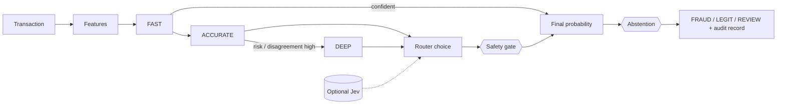

# DecisionRouter Pro

**Cost-aware ML model routing for fraud scoring: cheap model first, escalate only when uncertain, with a deterministic safety gate, a human-review outcome and an audit trail.**

A transaction arrives. Three model tiers can score it, at proxy costs 1 / 3 / 8:

| Tier | Model | Proxy cost |
|---|---|---|
| FAST | Logistic regression | 1 |
| ACCURATE | Histogram gradient boosting | 3 |
| DEEP | Small MLP (scikit-learn) | 8 |

A router decides how far up the ladder to go. A deterministic safety gate can only escalate risky or contested cases to DEEP. An abstention rule sends near-threshold cases to human **REVIEW**. Every decision gets an audit record and a plain-language explanation. An optional [TypeSafe Jev](https://typesafe.ai) layer can pick the tier; it never predicts fraud and cannot bypass the gate.

> **Honesty note.** Costs and latencies are configurable *proxies*, not cloud prices. The default dataset is synthetic. Differences smaller than the bootstrap intervals are not claimed as wins. The Jev layer has been tested with fake clients only and is **not evaluated** on real API calls.

Paper: *Cost-Aware Cascade Routing for Fraud Classification: Uncertainty, Safety Gating and Abstention* (arXiv link: TBD).

## How it works



- **Policies:** always-fast, always-accurate, always-deep, a *confidence* cascade, a *risk-aware* cascade, and an optional *jev* policy.
- **Cost accounting:** cascades are charged for **every tier they run**, so a full escalation costs 1 + 3 + 8 = 12 units, more than always-deep.
- **Uncertainty signals:** confidence `max(p, 1-p)`, binary entropy, cross-tier disagreement, and a cheap rule-based risk score.
- **Safety gate:** forces DEEP if risk >= 0.82 or disagreement >= 0.38. It is deterministic and escalate-only.
- **Abstention:** REVIEW if the probability is within 0.08 of the fraud threshold, or disagreement >= 0.50.
- **Calibration:** none, Platt or isotonic, chosen per model by cross-validated Brier score on the validation split.

All thresholds live in `configs/routing.yaml`.

## Quick start

Requires Python 3.10 or newer.

```bash
git clone https://github.com/ChaudhariKshitij/<repo>.git
cd <repo>
python -m venv .venv
source .venv/bin/activate          # Windows PowerShell: .venv\Scripts\Activate.ps1
pip install -r requirements.txt
```

The repository does not ship generated data or trained models, so create them first:

```bash
python scripts/generate_data.py    # synthetic transactions -> data/
python scripts/train.py            # trains the 3 tiers -> artifacts/models/
python scripts/benchmark.py        # routing benchmark -> artifacts/
python scripts/stress_test.py      # adversarial slices
python scripts/drift_test.py       # distribution-shift scenarios
python scripts/make_report.py      # artifacts/reports/final_report.md
```

To match the numbers in the paper exactly, use `pip install scikit-learn==1.8.0`. Other scikit-learn versions give slightly different metrics.

### Run the dashboard

```bash
streamlit run app/streamlit_app.py
```

Open http://localhost:8501. Pages: Overview, Single transaction, Model comparison, Routing benchmark, Routing distribution, Stress testing, Distribution shift, Jev.

### Run the API

```bash
uvicorn app.api:app --reload
```

Open http://localhost:8000/docs for interactive documentation (the root `/` returns 404 by design).

```bash
curl -s localhost:8000/health
curl -s -X POST 'localhost:8000/route?policy=risk_aware' -H 'content-type: application/json' -d '{
  "amount":450,"hour":2,"account_age_days":30,"device_seen_before":0,"merchant_seen_before":1,
  "transactions_24h":8,"avg_amount_30d":120,"distance_from_home_km":350,"international":1}'
```

Endpoints: `GET /health`, `POST /route`, `POST /route/batch`, `POST /route/raw`, `POST /route/raw/batch`, `POST /shadow-route`, `POST /explain`, `GET /benchmark`, `GET /metrics`, `GET /model-info`, `GET /audit/{request_id}`. Decisions are appended to `artifacts/audit/decisions.jsonl` (model outputs only, no personal data).

### Run the tests

```bash
pytest -q
```

61 tests cover the models, uncertainty maths, every policy, the safety gate, abstention, the Jev fallback and shadow mode (fake clients), the API and the dashboard.

### Docker

```bash
docker build -t decision-router .
docker run -p 8000:8000 decision-router     # trains on first start if no artifacts exist
docker compose up                           # API on :8000, dashboard on :8501
```

## Results

All numbers are from one seeded synthetic run (24,000 transactions, 6.2% fraud; test split of 4,800 rows with 297 frauds). Re-generate them with the commands above.

| Policy | PR-AUC | Recall | Avg cost | FAST / ACC / DEEP (%) |
|---|---|---|---|---|
| Always FAST | 0.594 | 0.448 | 1.00 | 100 / 0 / 0 |
| Always ACCURATE | 0.633 | 0.576 | 3.00 | 0 / 100 / 0 |
| Always DEEP | 0.617 | 0.519 | 8.00 | 0 / 0 / 100 |
| Confidence cascade | 0.616 | 0.515 | 1.94 | 90.5 / 1.0 / 8.5 |
| Risk-aware cascade | 0.617 | 0.515 | 1.93 | 87.1 / 5.8 / 7.1 |

- The risk-aware cascade is **75.8% cheaper than always-deep** with no measurable PR-AUC difference (paired bootstrap, +0.001, 95% CI [-0.009, +0.013]).
- It does **not** beat always-accurate, which is cheaper than always-deep and scored higher (PR-AUC 0.633, recall 0.576). The saving over the best fixed model is not established.
- Disagreement predicts FAST-tier errors (AUC 0.876) but no better than FAST's own entropy (0.884).
- Under simulated shift, disagreement and escalation rose (router cost 2.01 to 2.77 units) without quality loss.

**Real-data case study (ULB credit-card fraud, temporal split, 75 test frauds).** The cascades cost 1.32 (risk-aware) and 2.64 (confidence) units against 8.00 for always-deep, with PR-AUC 0.797 and 0.818 against 0.815. With 75 frauds, gaps of about 0.02 are inside sampling noise, so this shows the cost pattern, not a quality win.

The full tables (model quality, calibration, slices, adversarial cases, drift) are written to `artifacts/reports/final_report.md` by `scripts/make_report.py`.

## Using real data (ULB credit-card dataset)

Download `creditcard.csv` yourself from [Kaggle](https://www.kaggle.com/datasets/mlg-ulb/creditcardfraud/data) and check the dataset licence. The file is not included in this repository. Keep real results in separate folders so the synthetic ones stay intact.

**Linux / macOS (bash):**

```bash
export DR_CONFIG=configs/creditcard.yaml DR_ARTIFACTS_DIR=artifacts_real DR_DATA_DIR=data_real
python scripts/prepare_real_data.py --dataset creditcard --csv /path/to/creditcard.csv
python scripts/train.py
python scripts/tune_thresholds.py --out configs/creditcard.tuned.yaml
export DR_CONFIG=configs/creditcard.tuned.yaml
python scripts/benchmark.py && python scripts/stress_test.py && python scripts/drift_test.py && python scripts/make_report.py
```

**Windows (PowerShell):** replace each `export NAME=value` with `$env:NAME="value"`.

The report is written to `artifacts_real/reports/final_report.md`. The split is chronological (earliest rows train, latest rows test), so there is no look-ahead. Confidence is near 0.999 for almost every row at 0.17% fraud, so thresholds must be re-tuned (`tune_thresholds.py`) rather than reused from the synthetic config. Expect wide confidence intervals with so few test frauds.

## Optional: TypeSafe Jev

Jev is off by default and everything runs offline without it.

```bash
pip install -r requirements-jev.txt
cp .env.example .env               # then edit .env
# JEV_ENABLED=true
# TYPESAFE_API_KEY=your-key
```

- **Dashboard:** open the sidebar expander **Jev (optional)**, paste the key, switch Enable Jev on and press Test. The key stays in the server session and is never written to disk or logs.
- **API / benchmark:** set the two environment variables, then use `POST /route?policy=jev` or `POST /shadow-route`, or re-run `scripts/benchmark.py`.
- Any failure (disabled, missing key, timeout, error, invalid answer) falls back to the local risk-aware router, and the safety gate still runs afterwards. **Never commit your key.**

## Troubleshooting

| Problem | Fix |
|---|---|
| `ModuleNotFoundError: No module named '_loss'` or another error loading `.joblib` models | Your scikit-learn version differs from the one that saved the models. Re-run `python scripts/train.py` or `pip install scikit-learn==1.8.0`. |
| `/health` shows `load_error`, or `/route` returns 503 | Models are missing. Run the quick-start steps above. |
| `GET /` returns 404 | Expected. Use `/docs`. |
| `$env:` lines fail in bash | Those are PowerShell. Use `export NAME=value` in bash. |

## Repository layout

```
src/         models, uncertainty, policies, safety gate, abstention, router, audit, evaluation, Jev adapter
app/         FastAPI service (api.py) and Streamlit dashboard (streamlit_app.py)
scripts/     data generation, training, benchmark, stress and drift tests, report builder, real-data prep
configs/     routing.yaml (synthetic) and creditcard.yaml (real data)
tests/       pytest suite
docs/        resume bullets, interview story, production roadmap
artifacts/   reports and benchmark outputs
```

## Limitations

- The default data is synthetic and produced by a known process, so absolute metrics say nothing about real fraud.
- Test splits are small: about 300 frauds (synthetic) and 75 (ULB). PR-AUC differences below about 0.03 are within noise.
- Costs and latencies are proxies. Measured single-row latency on one host did not follow the 1 : 3 : 8 ratios.
- Disagreement is a heuristic, not calibrated epistemic uncertainty, and it needs every tier to run.
- The DEEP tier is a small scikit-learn MLP and does not outperform gradient boosting here.
- The Jev layer is not evaluated against the real API.

## Future work

Learned cost-sensitive routers, rolling-origin temporal evaluation, a second real dataset (for example IEEE-CIS), batched and under-load latency measurement, drift monitors based on score and disagreement distributions, and a real Jev shadow-mode evaluation with confidence intervals. See `docs/PRODUCTION_ROADMAP.md`.

## Citation

If you use this code, please cite the paper (arXiv link: TBD) and the dataset: A. Dal Pozzolo, O. Caelen, R. A. Johnson and G. Bontempi, "Calibrating probability with undersampling for unbalanced classification," IEEE SSCI, 2015.

## License

See `LICENSE`.
